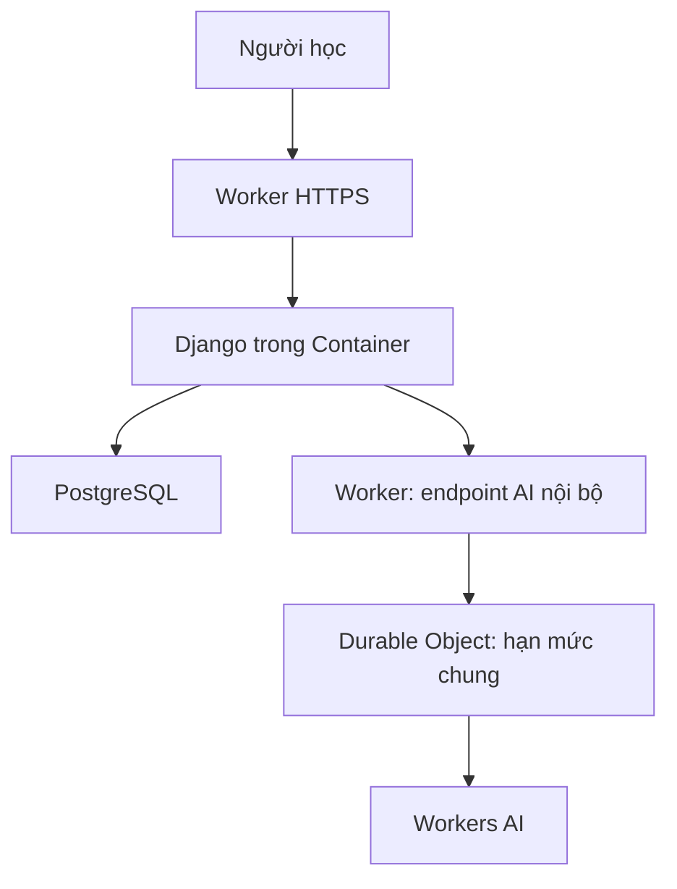

# TOEIC AI Tutor — Cloudflare Workers AI

Bản cập nhật 24/10/2026 của LinguaPath; xem [ngữ cảnh, lịch sử nguồn và quota M3](STABILITY_M3.md). Đây là mã nguồn và cấu hình triển khai đã kiểm tra cục bộ; **chưa có URL production, chưa gọi Workers AI thật**. Giữ Django và PostgreSQL để bảo toàn các transaction, tài khoản, kết quả và lịch ôn hiện có. Không viết lại dự án bằng React/FastAPI hoặc chuyển dữ liệu Django sang D1 trong đợt này.

## Chức năng có thể sử dụng

| Khu vực | Đã triển khai | Giới hạn |
| --- | --- | --- |
| Hỏi kiến thức | Tra từ trong học liệu hiện có; thêm 8 ghi chú về ngữ pháp/chiến thuật, ví dụ song ngữ và liên kết nguồn | Tra cứu từ khóa, chưa dùng embedding; ghi chú AI hỗ trợ biên soạn chưa được giảng viên duyệt |
| Giải câu đã làm | Gửi ngữ cảnh câu hỏi từ kết quả; lấy lời giải và lựa chọn của câu đã nộp trong tài khoản hiện tại | Không cho xem đáp án câu chưa nộp hoặc lượt của người khác; chưa nhận ảnh/OCR |
| AI diễn giải | Django gửi nguồn liên quan qua Worker để Workers AI diễn giải bằng tiếng Việt | Phải chọn chế độ AI; chưa đo độ đúng hay chất lượng mô hình thật |
| Luyện tập | Gợi ý 3 bộ đã xuất bản đúng kỳ thi và mức CEFR hiện tại; liên kết Vocabulary, Cloze, Reading, Listening | Dùng kho hiện có, không coi CEFR là quy đổi điểm TOEIC; không hứa đạt 750–900 |
| Tiến độ | Tổng số câu, tỷ lệ đúng có trọng số và kỹ năng trong 30 ngày; nhóm lỗi chưa ôn trong sổ tay | Tính từ dữ liệu đã nộp của chính người học; không dùng LLM để bịa điểm hoặc kết luận trình độ |
| Nhiệm vụ | Gọi planner hiện có qua thao tác POST; hiện lý do, thời lượng, trạng thái và liên kết học | Rule-based, không phải mô hình gợi ý đã huấn luyện; không tự sửa mục tiêu/đánh dấu xong |
| Lịch sử | Lưu tối đa 50 lượt hỏi/tài khoản, hiển thị 8 lượt gần đây; mở lại và xóa lịch sử riêng | Chưa gửi lịch sử làm bộ nhớ hội thoại cho LLM; bản ghi lưu nội dung câu hỏi và kết quả |
| Admin AI | Soạn 3 câu Part 5 từ một trong 6 ghi chú ngữ pháp, kiểm tra JSON và lưu một bộ nháp với 12 lựa chọn | Cần Workers AI; không tự xuất bản, không chứng minh đáp án đúng bằng kiểm tra cấu trúc |
| Nghe/phát âm | Giữ audio và TTS của thư viện hiện có | Chưa có nhận dạng giọng nói, ghi âm, đánh giá phát âm hoặc TOEIC Speaking |

Sinh đề đủ Part 1–7, bài thi thử đủ độ dài, OCR, hội thoại bằng micro, nhắc học tự động, đánh giá Writing/Speaking và function calling do mô hình tự chọn công cụ chưa được triển khai. Các thao tác tiến độ/lập lịch hiện là công cụ phía máy chủ do người học chủ động chọn, không phải autonomous agent.

## Kiến trúc và luồng xử lý



1. Django xác thực phiên, CSRF và quyền sở hữu câu hỏi. Chỉ câu đã nộp của người học hoặc học liệu cho phép xem mới được truy xuất. Ghi chú ngữ pháp có trạng thái AI rà soát sơ bộ riêng.
2. Chế độ tra cứu trả nội dung nguồn, không gọi nhà cung cấp AI. Khi chủ động chọn AI, Django đóng gói tối đa 5.400 ký tự nguồn: giữ nguyên đề, lựa chọn, khóa đúng và lời giải từng phương án trước phần đoạn văn/lời thoại; loại lời thoại trùng. Cấu trúc lỗi hoặc phần thiết yếu không vừa thì trả học liệu gốc, không đặt lượt/gọi model. Phần stimulus dài có thể được trích đoạn với nhãn rõ. Sau kiểm tra, Django đặt đồng thời lượt cá nhân và lượt chung trong DB, rồi gửi câu hỏi tối đa 500 ký tự.
3. `POST /internal/tutor/infer` kiểm tra bearer secret, cờ bật/tắt, kiểu và kích thước dữ liệu. Không nhận model, system prompt hoặc URL do trình duyệt lựa chọn. Endpoint không dùng cookie người học, không có CORS công khai.
4. `TutorAIBudget` giữ bộ đếm toàn hệ thống trong một Durable Object, đặt lượt bằng storage transaction trước khi gọi mô hình. Không lưu prompt/đáp án vào Durable Object này.
5. Workers AI nhận system prompt cố định. Nhánh giải thích dùng tối đa 450 output tokens; nhánh soạn nháp 1.200. Kết quả giới hạn 6.000 ký tự; lỗi/đầu ra không hợp lệ trả thông báo chung. Không tự retry.
6. Django lưu lượt hỏi riêng, phiên bản nguồn và metadata provider/model/prompt/context rồi redirect sang GET. Bridge báo model identifier thực được Worker chọn; bridge cũ không báo thì model để trống. Identifier có thể là alias, không chứng minh phiên bản trọng số cố định. Mở lịch sử kiểm tra lại nguồn, giữ nguyên câu trả lời và ghi rõ nguồn đổi/thu hồi/chưa xác minh; không gọi thêm mô hình. Nếu dịch vụ lỗi hoặc hết lượt, trả lại học liệu.

Lịch sử không được đưa vào yêu cầu AI. Không gửi email, username, ID tài khoản, điểm số hoặc toàn bộ hồ sơ sang Workers AI. Câu hỏi tự nhập có thể chứa dữ liệu cá nhân: giao diện đề nghị người học tránh nhập các thông tin đó. Backend không ghi prompt, secret hoặc nội dung exception của nhà cung cấp vào log ứng dụng.

## Hạn mức mặc định

| Thiết lập | Giá trị | Nơi thực thi |
| --- | --- | --- |
| `AI_TUTOR_ENABLED` | `false` trong cấu hình Cloudflare | Django và Worker |
| `AI_TUTOR_DAILY_LIMIT` | 20 lượt/tài khoản/ngày | PostgreSQL qua Django |
| `AI_TUTOR_MINUTE_LIMIT` | 3 lượt/tài khoản/60 giây | PostgreSQL qua Django |
| `AI_TUTOR_GLOBAL_DAILY_LIMIT` | 200 lượt/ngày | DB qua Django cho mọi provider; thêm Durable Object cho Cloudflare |
| `AI_TUTOR_GLOBAL_MINUTE_LIMIT` | 20 lượt/60 giây | DB qua Django cho mọi provider; thêm Durable Object cho Cloudflare |

Lượt đã đặt, kể cả lỗi, vẫn tính. Tra cứu/tiến độ/lịch học không tính lượt. Admin soạn 3 câu dùng một request và cùng các hạn mức trên. Quota DB dùng ngày theo múi giờ Django; DO dùng ngày UTC và là lớp bảo vệ bổ sung, nên hai lớp có thể reset lệch nhau. Khi bị từ chối, transaction không trừ lượt cá nhân hoặc chung. Giá trị 0 chặn request mới; cấu hình lỗi/DB lỗi bị từ chối. Cờ tắt áp dụng cho yêu cầu mới; yêu cầu đã chạy có thể hoàn tất sau đó. Các hạn mức request và `max_instances=1` **không phải trần hóa đơn**: còn chi phí Worker, DO, Container, database và token mô hình. Bộ đếm DB chung cũng bảo vệ OpenAI khi chạy riêng với `AI_TUTOR_PROVIDER=openai`.

## Triển khai bằng tài khoản Cloudflare của chủ dự án

Chi tiết Container/PostgreSQL xem `DEPLOY_CLOUDFLARE.md`. Đây là các bước bổ sung cho AI Tutor, không thay thế việc chuẩn bị database, backup và HTTPS.

### 1. Xác thực và cấu hình

Máy triển khai cần Node, Docker hoạt động và quyền triển khai đúng tài khoản:

```bash
cd deploy/cloudflare
npm ci
npx wrangler login
npx wrangler whoami
docker info
```

Sửa `wrangler.jsonc`: tất cả hostname ví dụ phải được thay bằng hostname thật. `DJANGO_ALLOWED_HOSTS`, `DJANGO_CSRF_TRUSTED_ORIGINS` và `CLOUDFLARE_AI_ENDPOINT` phải khớp; endpoint có dạng `https://HOST/internal/tutor/infer`. Không dùng wildcard. Khi có nhiều tài khoản, đặt `account_id` đúng chủ sở hữu. Giữ cờ AI false trong lần triển khai đầu.

Đã khai báo `ai.binding=AI`, binding Durable Object `AI_BUDGET`, export lớp `TutorAIBudget` và migration Worker tag `v2`. Giữ nguyên migration tag `v1` của Container; không xóa/đổi namespace hoặc tên singleton khi cập nhật vì có thể làm thay đổi trạng thái.

### 2. Cấp secrets

Quản trị viên dùng chức năng soạn nháp cần quyền thêm và sửa LearningContent, Question, AnswerOption.

Dùng prompt riêng của Wrangler, không đặt giá trị vào command arguments, file cấu hình hoặc chat:

```bash
npx wrangler secret put DJANGO_SECRET_KEY
npx wrangler secret put DATABASE_URL
npx wrangler secret put AI_BRIDGE_SECRET
```

`AI_BRIDGE_SECRET`: chuỗi ngẫu nhiên ASCII 32–256 ký tự, khác Django secret. Worker truyền cùng giá trị vào container. Đây là khóa nội bộ của ứng dụng, không phải Cloudflare API token. Không cần OpenAI API key cho nhánh Cloudflare. Quyền Workers AI được cung cấp bằng binding của tài khoản triển khai.

Model hiện cấu hình: `@cf/meta/llama-3.3-70b-instruct-fp8-fast`. Có thể đổi model phía quản trị, nhưng cần kiểm tra hỗ trợ messages/response/max_tokens và đánh giá lại trước khi đưa người học vào dùng.

### 3. Release Django và deploy

Trong shell quản trị tin cậy đã được cấp biến môi trường production và kết nối PostgreSQL:

```bash
python manage.py check --deploy
python manage.py migrate --plan
python manage.py migrate --noinput
```

Migration0012 tạo `TutorTurn`; migration0020 thêm quota AI dùng chung. Backup rồi chạy `python manage.py migrate` đến0020 khi cập nhật database có người dùng. Không seed lại dữ liệu nền trong mỗi lần deploy; các seed cũ có thể cập nhật nội dung đã chỉnh sửa. Với database mới, xem đúng thứ tự nạp ở `DEPLOY_CLOUDFLARE.md` và `VOCABULARY_3000.md`.

Tại `deploy/cloudflare`, với Docker đã chạy:

```bash
npm run check
npm run deploy
npx wrangler containers list
```

Dry-run `--containers-rollout=none` chỉ xác minh gói Worker, **không** build/run image hoặc chứng minh database hoạt động. Không dùng cách này làm bằng chứng đã triển khai production.

### 4. Xác minh rồi bật AI

Kiểm tra `/healthz/`, đăng ký/đăng nhập, admin, CSS, MP3, flashcard, nộp bài và dữ liệu sau khi Container khởi động lại. Sau đó đặt `AI_TUTOR_ENABLED=true` trong Wrangler, triển khai lại và bảo đảm container nhận môi trường mới.

Dùng tài khoản thử nghiệm:

- Hỏi “Khi nào dùng despite và although?” ở chế độ tra cứu: có ghi chú, không giảm lượt.
- Chọn AI và hỏi lại: có diễn giải từ nguồn, giảm đúng một lượt. Tải lại GET kết quả: không giảm thêm.
- Hỏi từ không có trong nguồn: nhận thông báo thiếu học liệu; không tự chuyển sang hỏi tự do.
- Gửi câu chưa nộp/ID của người khác: không nhận được đáp án. Mở link lịch sử của tài khoản khác: 404.
- Thử hạn mức nhỏ có chủ đích trong môi trường staging: hết lượt vẫn đọc được nguồn. Kiểm tra đồng thời nhiều tài khoản để xác minh DO thật.
- Admin → Học liệu → “Soạn nháp Part 5 bằng AI”: kiểm tra ba câu được lưu ở trạng thái nháp. Kiểm tra nội dung, lưu chỉnh sửa, rồi duyệt ở lần lưu riêng. Bộ này chỉ vượt kiểm tra xuất bản khi có trạng thái `teacher_approved`, tên người duyệt và thời điểm duyệt.
- Tắt AI và triển khai lại: tra cứu, tiến độ, bài tập và kế hoạch vẫn dùng được.

Không đánh giá chất lượng bằng việc “có câu trả lời”. Cần một bộ câu hỏi do người có chuyên môn chấm độc lập, gồm đúng kiến thức, bám nguồn, phân tích phương án, thiếu nguồn và chỉ dẫn gây nhiễu. Bộ test truy xuất trong `TUTOR_V2.md` là số liệu lịch sử của phiên bản trước; chưa đo lại cho 3.016 thẻ và ghi chú mới.

## Kiểm chứng bản mã nguồn này

Kiểm tra: **248 Django tests + 42 Node tests đạt**. Sau các chỉnh sửa cuối về timeout/giữ lịch sử/quyền biên tập, 28 Django tests liên quan được chạy lại và đạt. `makemigrations --check --dry-run` không phát hiện thay đổi còn thiếu; migration0012 đã áp dụng vào SQLite cục bộ sau khi backup và kiểm tra toàn vẹn. `collectstatic` ở cấu hình production đạt. Wrangler dry-run `--containers-rollout=none` xác nhận gói Worker 61,62 KiB với APP, AI_BUDGET và AI bindings; không deploy và không build Container. Các phép gọi mô hình trong automated tests dùng mock: không chứng minh mô hình thật trả lời đúng. Môi trường hiện chưa xác thực Cloudflare (`wrangler whoami` báo chưa đăng nhập), không có Docker CLI và chưa được cấp PostgreSQL production. Chưa có kiểm thử trình duyệt trực quan, kết nối AI thật, image thật, tải thực hay URL production.

## Mã nguồn liên quan

- `learning/ai.py`, `ai_provider.py`: truy xuất và chọn nhà cung cấp; fallback giữ nguồn.
- `learning/tutor_knowledge.py`: 8 ghi chú gốc, nhãn chưa giảng viên duyệt.
- `learning/tutor_tools.py`: tiến độ và kế hoạch bằng dữ liệu/quy tắc.
- `learning/models.py`, migration0012: lịch sử riêng theo user.
- `learning/ai_drafts.py`, `learning/admin.py`: soạn/kiểm tra/lưu nháp Part 5.
- `deploy/cloudflare/ai-gateway.js`: kiểm tra endpoint, hạn mức chung, system prompt.
- `deploy/cloudflare/worker.js`, `router.js`, `wrangler.jsonc`: binding, routing, secrets, migration DO.
- `learning/test_cloudflare_tutor.py`, `scripts/test_workers_ai.cjs`: quyền dữ liệu, hạn mức, redirect, draft và transport.

Nguồn chính thức đối chiếu ngày 21/10/2026:

- https://developers.cloudflare.com/workers-ai/configuration/bindings/
- https://developers.cloudflare.com/workers-ai/models/llama-3.3-70b-instruct-fp8-fast/
- https://developers.cloudflare.com/containers/get-started/
- https://developers.cloudflare.com/containers/platform/pricing/
